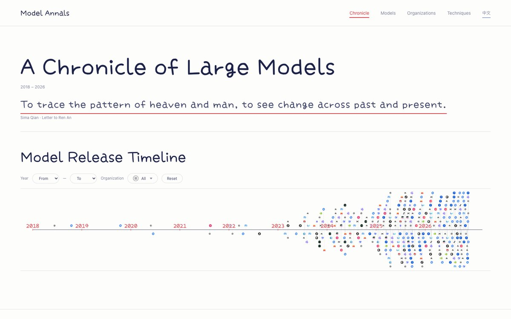

<div align="center">

# Model Annals

**A visual chronicle of large models, their organizations, and the techniques behind them.**

**English | [中文](README.md)**

[](web/index-en.html)
[](web/companies-en.html)
[](web/tech-en.html)
[](#running)
[](#sources-and-limits)

</div>

> **Scope.** A **purely static, data-driven** atlas of **357 models**, **21 organizations** and **48 key techniques** spanning 2018–2026. No backend, no build step, no external API. Every entry links to its original source, and **undisclosed data is left blank rather than guessed**. All content derives from a single source, `data/atlas.json`; pages are generated by scripts.

**Live site:** [https://carlyuhq.github.io/Model-Annals/index-en.html](https://carlyuhq.github.io/Model-Annals/index-en.html) · [中文版](https://carlyuhq.github.io/Model-Annals/)



## What it solves

The hard part of reading model history is not finding sources — it is **seeing time and relationships clearly**. Model Annals cuts one dataset into four views:

- **One axis for the whole picture** — 357 models placed by their actual release month, with organization logos as points. Filter by year range and organization; filtered points reflow evenly while the tick marks change in step (motion inspired by `CarlYuHQ/ccfddls`).
- **One chart for capability growth** — 90 representative models on a log-scale *time × context length* plot. Undisclosed context sits in its own band, coincident points are spread apart, and hovering reveals details.
- **One card per organization** — model counts, latest release, model families and open-weight counts for 21 organizations, each with its logo.
- **A mini-essay behind every technique** — all 48 techniques open into a short post with the original paper, proposing organization, core mechanism, impact, related models and links to related techniques. Every sentence comes from structured fields; no new claims are introduced.

## Four pages

| Page | Contents |
|---|---|
| [Chronicle](web/index-en.html) / [中文](web/index.html) | Horizontal release timeline, year-range and organization filters, nearest-point hover, wheel zoom |
| [Models](web/models-en.html) / [中文](web/models.html) | Log-scale scatter plot + specifications table, logo index filter |
| [Organizations](web/companies-en.html) / [中文](web/companies.html) | Statistics cards for 21 organizations, region filter |
| [Techniques](web/tech-en.html) / [中文](web/tech.html) | 48 technique cards, each opening into a sourced mini-essay |

**Bilingual:** switch with `English / 中文` at the top right of every page. Both languages share one CSS/JS codebase; text comes from the `assets/i18n.js` dictionary and `*-en.js` datasets. The Chinese HTML files are the single source — rerun the generator to sync.

## Running

No dependencies, no build. Open `web/index-en.html` directly (`file://` works), or:

```bash
python3 -m http.server 8000 --directory web
# http://localhost:8000/index-en.html
```

GitHub Pages serves the `gh-pages` branch (root directory). On every push to `main`, [`.github/workflows/pages.yml`](.github/workflows/pages.yml) syncs `web/` into that branch's root and Pages rebuilds automatically.

## Regenerating

```bash
python3 scripts/build_data.py          # merge data/raw/ into data/atlas.json
python3 scripts/build_web_data.py      # atlas.json -> web/assets/*-data.js
python3 scripts/build_en_data.py       # atlas.json -> web/assets/tech-data-en.js
python3 scripts/build_en_pages.py      # Chinese HTML -> four English HTML files (idempotent)
```

After editing data, rerun in that order. The Chinese HTML files are the single source; do not edit `*-en.html` by hand.

## Layout

```
model-annals/
├── web/                     # site root (deployed to Pages)
│   ├── index.html           # Chinese chronicle
│   ├── *-en.html            # four generated English pages
│   └── assets/
│       ├── site.css         # Wang Hong academic-handwritten design system
│       ├── i18n.js          # UI dictionary (zh / en)
│       ├── *-data.js        # data layer (zh / en)
│       └── logos/           # 21 organization logos
├── data/atlas.json          # single source of truth
├── docs/preview.jpg         # README screenshot
└── scripts/                 # generators
```

## Design

Wang Hong academic-handwritten style: near-white paper, deep-blue handwritten lettering (Xiaolai), short red rules, local highlighter, generous whitespace. Titles and epigraphs are written character by character, with the red underline drawn stroke by stroke. No gradients, glassmorphism or emoji clusters. Respects `prefers-reduced-motion`.

## Sources and limits

Data comes primarily from official release pages, system cards, technical reports and papers. Some late-2026 release dates come from reputable press or industry timelines and are marked in each entry's `note`. Undisclosed fields display as "Undisclosed" and are never replaced with zero. Data current as of 2026-11-19.

---

<div align="center">

[中文](README.md) · [Live site](https://carlyuhq.github.io/Model-Annals/index-en.html) · [Repository](https://github.com/CarlYuHQ/Model-Annals)

</div>
