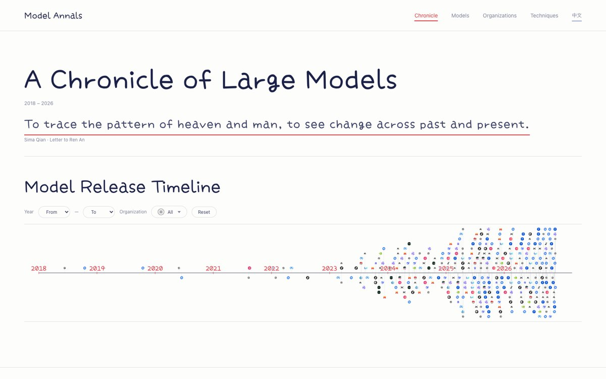

# Model Annals

**A visual chronicle of large models, their organizations, and the ideas behind them.**

**English | [中文](README.zh-CN.md)**

> **Scope.** A source-linked reference, not a ranking and not a benchmark. **357 models**, **21 organizations** and **48 key techniques**, 2018–2026. Every entry points to its original source; **anything never disclosed is left blank rather than guessed**.

**[Browse the site →](https://carlyuhq.github.io/Model-Annals/index-en.html)**

Reading model history is hard not because sources are scarce, but because **time and relationships are hard to see**. Model Annals reads one dataset from four angles.

- **One axis for the whole picture.** 357 models placed by their actual release month, each marked with its organization's logo. Filter by year range or organization; filtered points reflow while the timeline redraws in step.
- **One chart for capability.** 90 representative models on a log-scale *release date × context length* plot. Undisclosed context has its own band, coincident points spread apart, and hovering reveals the details.
- **One card per organization.** Model counts, latest release, model families and open-weight counts for 21 organizations, each with its logo.
- **One short essay per technique.** All 48 techniques open into a sourced note with the original paper, who proposed it, the core mechanism, its impact, related models and neighbouring techniques. Nothing is asserted beyond the underlying record.

## The four views

| View | What you get |
|---|---|
| [Chronicle](https://carlyuhq.github.io/Model-Annals/index-en.html) | Horizontal release timeline, year and organization filters, nearest-point hover, wheel zoom |
| [Models](https://carlyuhq.github.io/Model-Annals/models-en.html) | Log-scale scatter plot and a specifications table |
| [Organizations](https://carlyuhq.github.io/Model-Annals/companies-en.html) | Organization profiles with logos, filterable by region |
| [Techniques](https://carlyuhq.github.io/Model-Annals/tech-en.html) | 48 technique cards, each opening into a sourced short note |

Every page has an `English / 中文` switch. Both languages share one codebase; the Chinese pages are the single source and the English ones mirror them.

## Design

Wang Hong's academic-handwritten style: near-white paper, deep-blue handwriting, short red rules, local highlighter and generous whitespace. Titles and epigraphs are written character by character, with the red underline drawn stroke by stroke. No gradients, glassmorphism or emoji clusters; motion respects `prefers-reduced-motion`.

## Sources

Sources are primarily official release pages, system cards, technical reports and papers. Where a late-2026 date comes from reputable press or an industry timeline, the entry says so. Undisclosed fields read *Undisclosed* and are never replaced with zero. The record is current as of 2026-11-19.

---

[Live site](https://carlyuhq.github.io/Model-Annals/) · [中文](README.zh-CN.md) · [Repository](https://github.com/CarlYuHQ/Model-Annals)

