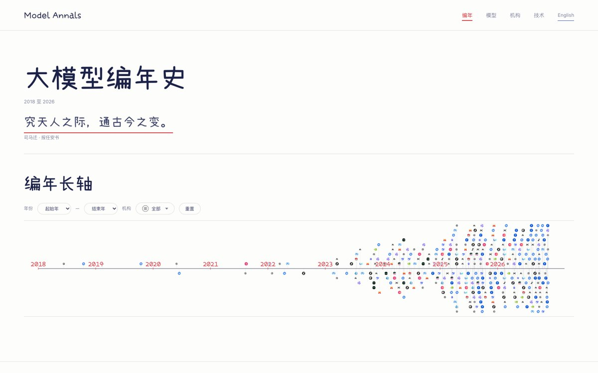

# Model Annals

**大模型编年史 — 一部关于模型、机构与关键技术的可视化档案。**

**[English](README.md) | 中文**

> **范围。** 这是一份**逐条附来源的参考资料**，不是榜单，也不是评测。收录 **357 个模型**、**21 家机构**、**48 项关键技术**，时间跨度 2018—2026。每个条目都指向原始来源；**未公开的数据一律留空，不做推测**。

**[打开站点 →](https://carlyuhq.github.io/Model-Annals/)**

读模型史的难点不在资料少，而在**时间与关系不容易看清**。Model Annals 用四个视角读同一份数据。

- **一条轴看全貌。** 357 个模型按真实发布月份铺开，机构 logo 作点。可按年份区间与机构筛选；筛选后点重新排布，时间刻度同步重画。
- **一张图看能力。** 90 个代表模型放在「发布时间 × 上下文长度」的对数坐标上。未公开上下文单独成带，同坐标点自动错开，悬停显示详情。
- **一张卡看机构。** 21 家机构的模型数、最新发布、模型谱系与开放权重数量，均带机构 logo。
- **每项技术一篇短文。** 48 项关键技术点开后，可看到原始论文、提出机构、核心机制、影响、关联模型与同类技术。所有表述都来自已有记录，不额外添加论断。

## 四个视角

| 视角 | 内容 |
|---|---|
| [编年](https://carlyuhq.github.io/Model-Annals/) | 横向发布长轴，年份与机构筛选、就近吸附、滚轮缩放 |
| [模型](https://carlyuhq.github.io/Model-Annals/models.html) | 对数散点图与规格表 |
| [机构](https://carlyuhq.github.io/Model-Annals/companies.html) | 带 logo 的机构档案，按地区筛选 |
| [技术](https://carlyuhq.github.io/Model-Annals/tech.html) | 48 张技术卡片，点开为附来源的短文 |

每页右上角可切换 `English / 中文`。两种语言共用同一套代码，中文页是唯一源，英文页与之对应。

## 设计

王虹学术手写风：近白纸面、深蓝手写字、短红线、局部荧光、大量留白。标题与名言逐字入场，名言下的红线逐笔画出。不使用渐变、玻璃拟态或 emoji 堆砌；动画遵循 `prefers-reduced-motion`。

## 来源

来源以机构官方发布页、系统卡、技术报告与论文为主。少数 2026 年下半年的日期来自可靠媒体或行业时间线，条目中已注明。未公开的字段显示为「未公开」，绝不以 0 代替。资料截止 2026-11-19。

---

[在线站点](https://carlyuhq.github.io/Model-Annals/) · [English](README.md) · [仓库](https://github.com/CarlYuHQ/Model-Annals)

